# 🏙️ CityMind Quest — The Mayor's Sustainability Challenge

[](https://sdgs.un.org/goals)
[](https://sdgs.un.org/goals)
[](https://www.typescriptlang.org/)
[](https://react.dev/)
[](https://nodejs.org/)
[](https://sqlite.org/)
[](https://aistudio.google.com/)

> **"Cities must balance energy use, waste and traffic while cutting emissions, controlling costs and keeping residents happy. These goals often pull in different directions."**  
> — *Gamathon Problem Statement PS 2.1*

**CityMind Quest** is a game-based municipal decision simulator where you take office as the newly elected Mayor. You progress through unlockable city levels, interact with specialist cartoon advisors, simulate and implement policies in real-time, weather surprise crises (heatwaves, factory closures, transit strikes), and consult **Gemi the Owl**—an AI municipal advisor powered by Google Gemini and a deterministic simulation engine.

---

## 🌟 Core Problem & Solutions

| Challenge Question | CityMind Quest Solution |
|---|---|
| **(a) How do you handle trade-offs between cost, emissions and citizen satisfaction?** | Every policy has mathematical multi-dimensional trade-offs. For example, *Building New Roads* cuts Downtown traffic (-15) but increases tailpipe emissions (+6) and drops resident happiness (-3). *Congestion Pricing* frees up streets (-10 traffic) but taxes commuters (-8 happiness). The live **Sustainability Index** normalizes these competing priorities based on council sliders. |
| **(b) How can good behaviour be recognised and rewarded fairly and not easily gamed?** | **Anti-Gaming Green Credits**: Credits are minted **only** when physical, measured zone emissions or traffic drops. Repeatedly clicking policies without net reductions earns 0 credits. Awards are capped at 15 GC per zone per month to prevent geographic bias, and every issuance is logged immutably in SQLite. |
| **(c) Can the effects of decisions be seen right away?** | **SIMULATE vs. IMPLEMENT**: Players can press **SIMULATE** to preview exact delta consequences across all 4 zones without spending a dollar. Pressing **IMPLEMENT** commits funds, updates the live city state, triggers audio, and advances the calendar. |

### 🎯 United Nations Sustainable Development Goals (SDGs)
- **SDG 11: Sustainable Cities & Communities** — Regional transit planning, congestion relief, and happiness equity across industrial and residential zones.
- **SDG 13: Climate Action** — Measurable greenhouse gas emissions reduction, grid resilience, and heat dome mitigation.
- **SDG 7: Affordable & Clean Energy** — Distributed rooftop solar adoption, grid-scale battery buffering, and peak load shaving.

---

## 🏗️ Architecture Diagram

```mermaid
graph TD
    subgraph Client["Frontend (React 18 + Vite + Tailwind + Howler)"]
        UI[Cartoon Overworld Hub /map]
        SimBtn[SIMULATE / PREVIEW Button]
        ImpBtn[IMPLEMENT Button]
        HUD[Live HUD: Index, Resilience, Treasury, Stars]
        Audio[Procedural Web Audio Synth]
        GemiUI[Gemi AI Owl Drawer /ai]
        ChaosUI[Judge Chaos Crisis Panel Ctrl+Shift+J]
    end

    subgraph Server["Backend (Node.js + Express + TypeScript)"]
        Router[Express REST API /api]
        Zod[Zod Input Validation]
        
        subgraph Engine["Deterministic Simulation Engine (Pure Functions)"]
            SimEngine[simulate state, action]
            ScoreCalc[Headline Scores & Sustainability Index]
            RecEngine[Recommendation & Runner-Up Justification]
            CrisisEngine[Crisis Mitigations & Shocks]
            DoctorEngine[Doctor 3-Step Recovery Plan]
            CreditEngine[Fair Anti-Gaming Green Credits]
            BadgeEngine[Achievement Unlocks]
        end

        subgraph AI["AI Layer (Google Gemini Free Tier)"]
            GeminiClient[GoogleGenerativeAI Service]
            RuleAdvisor[Rule-Based Offline Advisor Fallback]
            WhatIfParser[Structured What-If Intent Parser]
        end

        subgraph RealData["Meteorological Layer"]
            OpenMeteoGeo[Open-Meteo Geocoding API]
            OpenMeteoAQ[Open-Meteo Air Quality API PM2.5/PM10]
            OpenMeteoWeather[Open-Meteo Forecast API Temp]
            DataCache[SQLite Real-Data Cache & Offline JSON Fallback]
        end

        subgraph DB["Database (SQLite / node:sqlite)"]
            SessionsTable[(sessions)]
            LevelsTable[(unlocked_levels)]
            CreditsTable[(green_credits_log)]
            BadgesTable[(badges)]
            LeaderboardTable[(leaderboard)]
        end
    end

    SimBtn -->|POST /api/preview| Router
    ImpBtn -->|POST /api/implement| Router
    Router --> Zod --> SimEngine
    SimEngine --> ScoreCalc
    SimEngine --> CreditEngine --> CreditsTable
    ScoreCalc --> HUD
    Router --> OpenMeteoAQ --> DataCache
    GemiUI -->|POST /api/ai/chat| GeminiClient
    GeminiClient -->|Verified Numbers Only| ScoreCalc
    GeminiClient -.->|Offline / Missing Key| RuleAdvisor
    ChaosUI -->|POST /api/crisis| CrisisEngine
```



---

## 💻 Tech Stack & Rationale

- **Frontend**:
  - **React 18 + TypeScript + Vite**: Ultra-fast hot module reloading, strict typing, and instant page transitions.
  - **Tailwind CSS**: Custom cartoon palette, isometric shadows, responsive breakpoints (optimized for 1920x1080 and 1366x768).
  - **Framer Motion & Canvas Confetti**: Celebratory level fanfare, character bobbing, and before/after transition panels.
  - **Zustand**: Clean, reactive state management for city state, audio mute, and global modals.
  - **Recharts**: Responsive SVG line charts plotting the Sustainability Index by month with crisis markers.
  - **Web Audio & Howler**: Procedural sound effects (click, coin, celebration, siren, error) with zero missing asset dependencies.
- **Backend**:
  - **Node.js + Express + TypeScript**: Modular enterprise-grade server with Zod schema validation.
  - **Helmet, CORS & Rate Limiting**: Production security shielding API endpoints.
  - **SQLite (`node:sqlite` / `better-sqlite3`)**: Native file-based relational storage for sessions, badges, leaderboards, and immutable green credit audit trails.
- **AI Integration**:
  - **Google Gemini API (`gemini-2.5-flash`)**: High-speed, free-tier reasoning grounded exclusively in computed engine numbers.
  - **Graceful Offline Fallback**: If `GEMINI_API_KEY` is omitted or network drops, a rule-based advisor seamlessly takes over with a visible badge.
- **Real Meteorological Data**:
  - **Open-Meteo Geocoding, Air Quality, and Weather APIs**: Live PM2.5, PM10, AQI, and temperature feeds adjusting baseline city risk.
  - **Bundled Offline JSON**: Guarantees zero-network offline functionality.

---

## ⚡ Quick Start & Setup

### Prerequisites
- **Node.js** v18+ (tested on v20, v22, and v24)
- **npm** v9+

### 1. Clone & Install
```bash
# Clone the repository
git clone https://github.com/your-username/citymind-quest.git
cd citymind-quest

# Install dependencies across all workspaces
npm install
```

### 2. Configure Environment Variables (Optional)
CityMind Quest runs **100% offline out-of-the-box** using its intelligent rule-based municipal advisor. To connect Google Gemini:
1. Obtain a **FREE** API key from [Google AI Studio](https://aistudio.google.com/).
2. Copy `.env.example` to `.env`:
   ```bash
   cp .env.example .env
   ```
3. Add your key in `.env`:
   ```env
   PORT=4000
   GEMINI_API_KEY=your_gemini_api_key_here
   GEMINI_MODEL=gemini-2.5-flash
   CLIENT_ORIGIN=http://localhost:5173
   ```

### 3. Run the Development Server
One single command starts both backend (`:4000`) and frontend (`:5173`):
```bash
npm run dev
```
Open **[http://localhost:5173](http://localhost:5173)** in your browser!

### 4. Run Tests & Validation
```bash
# Run all simulation engine unit tests & API smoke tests (16 tests)
npm run test

# Build production bundles
npm run build

# Start production server (serves API and built client)
npm start
```

---

## 🎮 How to Play

1. **Title Splash (`/`)**: Toggle audio sound effects, review SDGs, click **START NEW TERM**.
2. **Mayoral Oath (`/create`)**:
   - Choose your Mayor avatar and name.
   - Search a real city (e.g. *London, Tokyo, Delhi, Paris*) to calibrate starting emissions against real Open-Meteo AQI, or pick *Sample City*.
   - Select Council Difficulty: *Easy* ($120 budget), *Normal* ($100), or *Hard* ($70).
3. **The City Map (`/map`)**:
   - Explore the illustrated cartoon metropolis.
   - Watch animated citizens whose facial expressions and mood auras react to live neighborhood happiness!
   - Unlock buildings sequentially:
     1. ⚡ **Helios Power Station** (Professor Volt)
     2. 🚌 **Metro Central Station** (Captain Zoom)
     3. ♻️ **EcoCycle Recovery** (Rina the Recycler)
     4. 🏛️ **City Hall Chambers** (Penny the Treasurer)
     5. 🚨 **Crisis Command Tower** (Chief Blaze)
4. **Levels & Decision Loop**:
   - Read the specialist NPC dialogue.
   - Select a policy card (e.g., *Rooftop Solar*, *Battery Storage*, *Increase Buses*).
   - Press **SIMULATE PREVIEW** to observe projected score deltas with zero financial risk.
   - Press **IMPLEMENT POLICY** to commit treasury funds, advance the month, and earn Green Credits!
5. **Surprise Crises & Judge Chaos Panel**:
   - Test city resilience against *Extreme Heatwaves*, *Factory Closures*, or *Transit Strikes*.
   - Judges can press **Ctrl+Shift+J** or click the **Chaos** button at any time!
   - Earlier investments in Battery Storage (-40% heat damage), Solar (-15%), or Buses (-30% strike traffic) visibly buffer your citizens.
6. **AI Advisor Gemi the Owl (`/ai`)**:
   - Ask municipal questions or simulate natural-language queries: *"What if I build solar twice?"*
7. **Mayor's Term Report (`/report`)**:
   - Inspect your monthly Sustainability Index trajectory on the interactive Recharts line chart.
   - Read the AI executive evaluation and click **Print / Download PDF** for a printer-ready audit report.

---

## ⏱️ 3-Minute Judge Demo Script

- **[0:00 - 0:30] Introduction & Problem Setup**:
  Open `http://localhost:5173`. Show cartoon aesthetics, click **START NEW TERM**. Type "London" and click *Fetch Open-Meteo* to demonstrate real air-quality & temperature ingestion. Click *Inaugurate City*.
- **[0:30 - 1:15] Level 1 & Deterministic Simulation**:
  On `/map`, click *Helios Power Station*. Introduce Professor Volt. Select *Rooftop Solar*, click **SIMULATE PREVIEW**. Point out that budget remains unchanged ($100). Click **IMPLEMENT POLICY**—observe fanfare, budget deducts to $80, month advances, and the top-3 score contributors appear. Return to `/map` to show *Metro Central Station* unlocked.
- **[1:15 - 1:55] Gemi AI Advisor & Natural Language What-If**:
  Click the *Gemi AI* button. Click *"What should I prioritize first?"* to showcase grounded, non-hallucinated advice with the Offline Advisor badge. Type *"What if I build solar twice?"*—demonstrate that the AI structures intent into code, executes the pure simulator, and returns verified numbers.
- **[1:55 - 2:30] Chaos Panel & Resilience Mitigation**:
  Press **Ctrl+Shift+J** to open the Judge Chaos Panel. Trigger *Extreme Heatwave* at Severe severity. The siren sounds, the screen alerts, and the report declares: *"Your earlier investment in Rooftop Solar reduced the damage by 15%!"* Show the Resilience Score formula and Doctor's 3-step recovery plan.
- **[2:30 - 3:00] Green Credits & Final Report**:
  Visit `/credits` to review the anti-gaming audit log in SQLite. Navigate to `/report` to show the monthly trajectory line chart and click *Download / Print PDF*.

---

## 📡 Complete API Reference

| Method | Endpoint | Description |
|---|---|---|
| `GET` | `/api/health` | System uptime, SQLite status, and Gemini model info |
| `GET` | `/api/city` | Current city state, headline scores, and unlocked badges |
| `POST` | `/api/preview` | **Pure function preview**—simulates an action without altering stored state |
| `POST` | `/api/implement` | Applies action, spends budget, advances month, logs green credits |
| `GET` | `/api/recommendation` | Scores all actions and returns best action + runner-up rationale |
| `POST` | `/api/priorities` | Updates council priority sliders (Environment, Happiness, Cost, Reliability) |
| `POST` | `/api/crisis` | Triggers a crisis (heatwave, factory closing, transport strike) at mild/severe/catastrophic |
| `GET` | `/api/doctor` | Generates 3-step emergency recovery plan based on active crisis |
| `GET` | `/api/explain` | Returns top 3 contributors explaining score shifts |
| `GET` | `/api/credits` | Returns Green Credits balance, fairness rules, and SQLite transaction logs |
| `POST` | `/api/difficulty` | Sets council difficulty (easy, normal, hard) |
| `POST` | `/api/reset` | Resets city state back to initial conditions |
| `POST` | `/api/session` | Creates or restores a player mayoral session |
| `GET` | `/api/leaderboard` | Fetches high scores from SQLite leaderboard |
| `GET` | `/api/levels` | Retrieves all 5 levels with unlocked status and star ratings |
| `POST` | `/api/levels/complete` | Marks level completed and awards stars |
| `GET` | `/api/realdata?city=...` | Fetches live or cached Open-Meteo AQI and temperature |
| `POST` | `/api/ai/chat` | Queries Gemi the Owl with verified simulation facts |
| `POST` | `/api/ai/explain` | Explains level debrief in the voice of the level NPC |
| `POST` | `/api/ai/whatif` | Parses natural language what-if query, runs pure simulator, returns real numbers |
| `GET` | `/api/report` | Generates final term audit report, history chart data, and executive narrative |

---

## 🔮 Limitations & Future Work

- **Live IoT Sensor Ingestion**: Connecting live municipal OpenData APIs (e.g. GTFS live bus transit feeds, city smart meter MQTT streams) for real-time digital twinning.
- **Machine Learning Predictive Forecasting**: Training regression models on historical city decisions to forecast 5-year municipal climate impacts.
- **Multiplayer Council Mode**: Allowing collaborative multi-role gameplay where one player acts as Transit Commissioner and another acts as Treasurer.

---

## 📜 License
MIT License. Built with passion for sustainable cities and communities.
